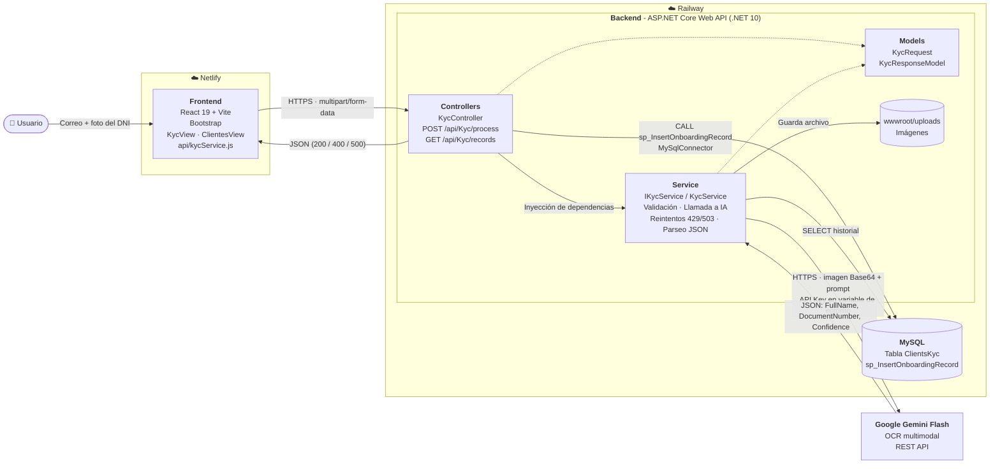

# Diagrama de Arquitectura - Onboarding KYC

## Componentes

| Capa | Tecnología | Responsabilidad |
|---|---|---|
| Frontend | React + Vite (Netlify) | Captura correo e imagen, muestra el resultado y el historial |
| Controller | ASP.NET Core | Recibe la petición HTTP, valida datos obligatorios y devuelve la respuesta |
| Service | C# | Lógica de negocio: guarda la imagen, llama a Gemini, interpreta su respuesta |
| Models | C# | Definen la forma de los datos que entran y salen de la API |
| IA / OCR | Gemini Flash | Extrae nombre, número de documento y nivel de confianza |
| Base de datos | MySQL (Railway) | Persistencia mediante Stored Procedure |
